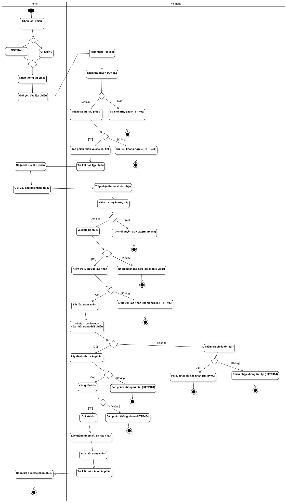

# Activity Diagram – Goods Receipt (BA3)

## 1. Mô tả

Activity Diagram mô tả quy trình nhập kho hiện tại của Inventory Management System, từ lúc Admin chọn loại phiếu `NORMAL` hoặc `OPENING`, lập phiếu, đến khi xác nhận và ghi nhận biến động kho. Sơ đồ sử dụng hai swimlane là **Admin** và **Hệ thống (API + Database)** để phân biệt thao tác của người dùng với xử lý backend. Quy trình xác nhận được đối chiếu với hàm `confirm()` trong Repository, trong đó cập nhật trạng thái phiếu, lấy danh sách sản phẩm, cộng tồn và ghi `stockMovement` được thực hiện trong cùng một transaction. Các nhánh từ chối thể hiện những trường hợp không đủ quyền, dữ liệu không hợp lệ, phiếu không tồn tại, phiếu đã xác nhận và các lỗi phát sinh khi xử lý chi tiết phiếu.

## 2. Sơ đồ



- File StarUML chỉnh sửa được: [`src/activity-goods-receipt.mdj`](./src/activity-goods-receipt.mdj)
- File hình xuất từ StarUML: [`activity-goods-receipt.svg`](./activity-goods-receipt.svg)

> Hai đường dẫn trên là các file cần được lưu cùng tài liệu này trong PR. File Markdown không thay thế file `.mdj` hoặc `.svg`.

## 3. Phạm vi và swimlane

Sơ đồ mô tả hiện trạng kỹ thuật của quy trình nhập kho theo các route và hàm backend được khảo sát.

| Swimlane | Trách nhiệm thể hiện trong sơ đồ |
|---|---|
| **Admin** | Chọn loại phiếu; nhập thông tin và danh sách sản phẩm; gửi yêu cầu lập phiếu; gửi yêu cầu xác nhận phiếu; nhận kết quả từ hệ thống. |
| **Hệ thống (API + Database)** | Tiếp nhận Request; xác thực và kiểm tra quyền; validate dữ liệu; tạo phiếu và các dòng chi tiết; xác nhận phiếu; cập nhật tồn kho; ghi sổ kho; trả kết quả hoặc thông báo lỗi. |

**Staff** không được tạo thành swimlane riêng. Staff chỉ xuất hiện tại nhánh bị từ chối quyền truy cập (`403 Forbidden`), theo phạm vi yêu cầu của Issue #126 và middleware `requireRoles(["admin"])` trong `goodsReceipt.routes.js`.

## 4. Nguồn tham chiếu

| Nguồn | Mục đích sử dụng |
|---|---|
| [Issue #126 – BA3: Activity: nhập kho (hiện trạng)](https://github.com/1275-B24-Academy/inventory-system/issues/126) | Phạm vi công việc, yêu cầu hai swimlane, các bước lập/xác nhận phiếu, nhánh lỗi và tiêu chí nghiệm thu. |
| [Issue #72 – Sổ kho & chứng từ](https://github.com/1275-B24-Academy/inventory-system/issues/72) | Thuật ngữ phiếu nhập, sổ kho và ý nghĩa phiếu `OPENING` là phiếu nhập tồn đầu kỳ. |
| [Issue #73 – Vòng đời chứng từ, duyệt phiếu & giữ hàng](https://github.com/1275-B24-Academy/inventory-system/issues/73) | Đối chiếu vòng đời chứng từ hiện tại; không đưa phần duyệt hai người và giữ hàng trong tương lai vào sơ đồ. |
| [Issue #111 – Epic BA: Sơ đồ nghiệp vụ & hệ thống](https://github.com/1275-B24-Academy/inventory-system/issues/111) | Quy ước và thuật ngữ khi xây dựng sơ đồ BA. |
| `server/src/routes/goodsReceipt.routes.js` | Xác định API lập phiếu, API xác nhận phiếu, middleware xác thực, phân quyền và validate request. |
| `server/src/services/goodsReceipt.service.js` | Xác định các kiểm tra `createdBy`, `confirmedBy` trước khi gọi Repository. |
| `server/src/repositories/goodsReceipt.repository.js` | Xác định thao tác tạo phiếu, ba bước trong transaction xác nhận, cập nhật tồn và ghi `stockMovement`. |

## 5. Actor và quyền truy cập trong quy trình

Trong Activity Diagram chỉ sử dụng hai swimlane **Admin** và **Hệ thống**. Quyền truy cập được thể hiện tại các Request, không phải bằng một swimlane Staff.

| Người dùng | Quyền theo route hiện tại | Cách thể hiện trong sơ đồ |
|---|---|---|
| **Admin** | Được phép gọi các API trong `goodsReceipt.routes.js` sau khi vượt qua middleware xác thực và phân quyền. | Thực hiện các thao tác lập phiếu và xác nhận phiếu. |
| **Staff** | Không thuộc role được cho phép bởi `requireRoles(["admin"])` trên router này. | Chỉ xuất hiện ở nhánh bị từ chối truy cập; không nối vào luồng lập hoặc xác nhận phiếu thành công. |

Router áp dụng middleware chung cho các route bên dưới:

```js
router.use(
  requireLogin,
  loadCurrentUser(userRepository),
  requireRoles(["admin"]),
);
```

Do lập phiếu và xác nhận phiếu là hai HTTP Request độc lập, middleware được chạy cho từng Request. Việc kiểm tra quyền ở đầu luồng xác nhận không có nghĩa Admin phải đăng nhập lại; đó là kiểm tra quyền của Request xác nhận.

> Mã `403` là kết quả được yêu cầu thể hiện trong Issue #126. Đoạn `goodsReceipt.routes.js` cho thấy middleware phân quyền được áp dụng, còn nội dung triển khai chi tiết của `requireRoles.js` chưa nằm trong các đoạn code được cung cấp để đối chiếu độc lập thông báo trả về.

## 6. Đối chiếu API và luồng xử lý

Các endpoint dưới đây là đường dẫn tương đối bên trong `goodsReceipt.routes.js`; URL đầy đủ phụ thuộc prefix dùng khi mount router trong ứng dụng.

| Chức năng | HTTP Method | Endpoint tương đối | Middleware / validate | Hàm Controller được gọi |
|---|---|---|---|---|
| Lập phiếu kèm sản phẩm | `POST` | `/` | `requireLogin`, `loadCurrentUser`, `requireRoles(["admin"])`, `validate({ body: createGoodsReceiptBody })` | `goodsReceiptController.createWithItems` |
| Xác nhận phiếu | `POST` | `/:id/confirm` | `requireLogin`, `loadCurrentUser`, `requireRoles(["admin"])`, `validate({ params: goodsReceiptIdParams })` | `goodsReceiptController.confirm` |

### 6.1. Lập phiếu nhập

1. Admin chọn loại phiếu `NORMAL` hoặc `OPENING`, nhập thông tin phiếu và danh sách sản phẩm, sau đó gửi Request `POST /`.
2. Hệ thống chạy `requireLogin`, `loadCurrentUser` và `requireRoles(["admin"])`; người không có role được phép bị chặn trước khi xử lý Controller.
3. Hệ thống validate Body bằng `createGoodsReceiptBody`, sau đó gọi `goodsReceiptController.createWithItems`.
4. `GoodsReceiptService.createWithItems()` kiểm tra `createdBy` phải là số nguyên dương. Nếu không hợp lệ, Service ném lỗi `400` với thông báo `ID người tạo không hợp lệ.`
5. `GoodsReceiptRepository.createWithItems()` tạo phiếu, lưu `created_by`, `receipt_type` và tạo các dòng chi tiết trong cùng lệnh Prisma nested create. Mỗi dòng lưu `product_id` và `quantity`; các dòng trả về được sắp xếp theo `id` tăng dần.
6. Hệ thống trả kết quả tạo phiếu cho Admin.

### 6.2. Loại phiếu NORMAL và OPENING

| Loại phiếu | Ý nghĩa | Bằng chứng trong code hiện tại |
|---|---|---|
| `NORMAL` | Phiếu nhập thông thường. | `createWithItems()` dùng `receiptType = "NORMAL"` làm giá trị mặc định và lưu vào trường `receipt_type`. |
| `OPENING` | Phiếu nhập tồn đầu kỳ, theo mô tả của Issue #126 và tài liệu #72. | Có thể truyền `receiptType` vào `createWithItems()` và được lưu vào `receipt_type`. |

Trong hàm `confirm()` được khảo sát, không có nhánh điều kiện riêng theo `receipt_type`. Vì vậy, sau khi chọn loại phiếu và tạo phiếu, hai loại hiện đi qua cùng logic xác nhận: cập nhật trạng thái, lấy chi tiết, cộng tồn và ghi `stockMovement`.

### 6.3. Xác nhận phiếu nhập

1. Admin gửi Request riêng `POST /:id/confirm`.
2. Router chạy lại các middleware `requireLogin`, `loadCurrentUser` và `requireRoles(["admin"])` cho Request xác nhận.
3. Hệ thống validate tham số `id` bằng `goodsReceiptIdParams`, sau đó gọi `goodsReceiptController.confirm`.
4. `GoodsReceiptService.confirm()` kiểm tra `confirmedBy` phải là số nguyên an toàn và lớn hơn 0. Nếu không hợp lệ, Service ném lỗi `400` với thông báo `ID người xác nhận không hợp lệ.`
5. Repository chạy các thao tác xác nhận bên trong `prisma.$transaction()` theo trình tự dưới đây.

### 6.4. Ba bước trong transaction

| Bước | Xử lý | Chi tiết code và kết quả |
|---|---|---|
| **1. Chuyển trạng thái phiếu** | Cập nhật `draft` → `confirmed`. | `updateMany()` chỉ khớp phiếu có `id = receiptId` và `status = "draft"`; đồng thời ghi `confirmed_by` và `confirmed_at`. Nếu `locked.count === 0`, hệ thống truy vấn lại phiếu để phân biệt không tồn tại (`404`) và đã tồn tại nhưng không còn ở trạng thái `draft` (`409`). |
| **2. Lấy danh sách sản phẩm** | Truy vấn các dòng chi tiết của phiếu. | `findMany()` lọc theo `receipt_id`, sắp xếp `product_id` tăng dần và lấy `id`, `product_id`, `quantity`. Nếu danh sách rỗng, Repository ném lỗi `400`. |
| **3. Cộng tồn và ghi sổ kho** | Lặp qua từng dòng chi tiết; cộng tồn sản phẩm rồi ghi biến động kho. | `product.updateMany()` tăng `stock` theo `quantity`. Nếu không tìm thấy sản phẩm (`count === 0`), Repository ném lỗi `404`. Nếu cập nhật được, `stockMovement.create()` tạo bản ghi với `receipt_item_id` và `quantity`. |

Sau khi xử lý hết các dòng chi tiết, Repository truy vấn lại phiếu bằng `findUnique()` và trả kết quả. Callback transaction hoàn tất thành công thì Prisma hoàn tất transaction; nếu có lỗi phát sinh trong callback thì transaction rollback các thay đổi của lần xác nhận đó.

## 7. Các nhánh lỗi và kết quả

Bảng dưới đây tổng hợp lỗi có căn cứ trong những đoạn code đã khảo sát và các nhánh bắt buộc theo Issue #126.

| Vị trí phát sinh | Điều kiện | HTTP status | Thông báo / kết quả |
|---|---|---:|---|
| Middleware phân quyền | Người gọi không có role `admin` | `403` theo yêu cầu thể hiện của Issue #126; cần đối chiếu implementation của middleware nếu cần xác nhận độc lập | Từ chối truy cập. |
| Service lập phiếu | `createdBy` không phải số nguyên dương | `400` | `ID người tạo không hợp lệ.` |
| Validate Body lập phiếu | Body không đáp ứng `createGoodsReceiptBody` | Chưa xác định từ đoạn code hiện có | Request bị validate từ chối; status và nội dung cụ thể phụ thuộc `validate.js` và schema. |
| Validate `id` xác nhận | Params không đáp ứng `goodsReceiptIdParams` | Chưa xác định từ đoạn code hiện có | Request bị validate từ chối; status và nội dung cụ thể phụ thuộc `validate.js` và schema. |
| Service xác nhận | `confirmedBy` không phải số nguyên an toàn dương | `400` | `ID người xác nhận không hợp lệ.` |
| Repository – Bước 1 | Không tìm thấy phiếu theo `receiptId` khi `locked.count === 0` | `404` | `Phiếu nhập không tồn tại.` |
| Repository – Bước 1 | Phiếu tồn tại nhưng không còn ở trạng thái `draft` khi `locked.count === 0` | `409` | `Phiếu nhập đã được xác nhận.` |
| Repository – Bước 2 | Phiếu không có dòng sản phẩm (`items.length === 0`) | `400` | `Phiếu nhập chưa có sản phẩm.` |
| Repository – Bước 3 | Không tìm thấy sản phẩm khi cập nhật tồn (`product.count === 0`) | `404` | `Sản phẩm trong phiếu không tồn tại.` |

### 7.1. Cách thể hiện lỗi trên Activity Diagram

- Mỗi điều kiện rẽ nhánh được đặt trên `Control Flow` dưới dạng Guard, ví dụ `[Có]`, `[Không]`, `[Admin]`, `[Staff]`, `[NORMAL]`, `[OPENING]`.
- Mỗi nhánh lỗi kết thúc bằng Action ghi kết quả, ví dụ `Phiếu nhập không tồn tại (HTTP 404)` hoặc `Phiếu nhập đã được xác nhận (HTTP 409)`, sau đó nối đến Activity Final.
- Các lỗi xảy ra bên trong transaction dẫn đến rollback toàn bộ thay đổi trong transaction; không để nhánh lỗi tiếp tục đi đến Commit.

## 8. Đối chiếu tài liệu và code hiện trạng

| Nội dung | Tài liệu / yêu cầu | Code hiện trạng | Cách phản ánh trong sơ đồ / điểm cần làm rõ |
|---|---|---|---|
| Quyền lập và xác nhận phiếu | Issue #126 yêu cầu Admin là làn thao tác chính; Staff chỉ xuất hiện ở nhánh 403. | `goodsReceipt.routes.js` áp dụng `requireRoles(["admin"])` cho toàn bộ router. | Chỉ nối Admin vào luồng thành công; Staff chỉ nối đến nhánh từ chối. |
| NORMAL và OPENING | `OPENING` là phiếu nhập tồn đầu kỳ theo #72 và mô tả Issue #126. | `createWithItems()` lưu `receipt_type`, mặc định là `NORMAL`; `confirm()` không phân nhánh theo loại phiếu. | Thể hiện hai lựa chọn khi lập phiếu rồi Merge về luồng chung; ghi rõ chưa thấy khác biệt trong logic xác nhận. |
| Tạo phiếu nháp | Có hàm `createDraft()` trong Service và Repository. | Hai route hiện có trong `goodsReceipt.routes.js` chỉ gọi `createWithItems` và `confirm`; không có route trong file này gọi `createDraft`. | Không đưa `createDraft()` vào luồng API chính được thể hiện bởi router này. Cần tìm kiếm toàn repository để xác nhận hàm không được gọi từ nơi khác. |
| Xác nhận phiếu | Issue #126 yêu cầu xác nhận, cộng tồn và ghi sổ. | Ba nhóm thao tác nằm trong cùng `prisma.$transaction()`. | Thể hiện ba bước theo thứ tự code và Note về rollback. |
| Duyệt phiếu hai người / giữ hàng | Được mô tả là phần tương lai trong Issue #73 và ngoài phạm vi BA3. | Không xuất hiện trong các hàm được cung cấp để khảo sát cho BA3. | Không đưa vào Activity Diagram hiện trạng. |

## 9. Assumptions và giới hạn khảo sát

1. **Hai swimlane:** Sơ đồ chỉ dùng `Admin` và `Hệ thống (API + Database)`. `Staff` chỉ xuất hiện ở nhánh bị từ chối quyền truy cập, không tạo swimlane riêng.
2. **Một Request cho mỗi thao tác:** Lập phiếu (`POST /`) và xác nhận phiếu (`POST /:id/confirm`) là hai Request độc lập. Vì router áp dụng middleware chung cho cả hai route, kiểm tra quyền được thực hiện ở cả hai Request; điều này không có nghĩa Admin phải đăng nhập lại.
3. **NORMAL và OPENING:** Sơ đồ thể hiện rõ hai lựa chọn theo yêu cầu. Theo code Repository hiện có, hai loại cùng đi qua hàm `confirm()` và chưa thấy quy tắc xử lý riêng theo `receipt_type` trong hàm này.
4. **`createDraft()`:** Hàm tồn tại trong Service và Repository, nhưng không được route nào trong `goodsReceipt.routes.js` gọi trực tiếp. Chưa kết luận hàm không được gọi ở nơi khác nếu chưa tìm kiếm toàn repository.
5. **Validate Body và Params:** Route sử dụng `createGoodsReceiptBody` và `goodsReceiptIdParams`, nhưng chưa có nội dung schema và `middlewares/validate.js` trong bộ code được cung cấp để xác nhận danh sách điều kiện, HTTP status và thông báo lỗi cụ thể.
6. **Mã 403:** Issue #126 yêu cầu thể hiện nhánh Staff bị từ chối với `403`. Router xác định role được phép là `admin`; cần xem implementation `requireRoles.js` nếu cần xác nhận đầy đủ response thực tế.
7. **Transaction:** Các thao tác xác nhận trong callback `$transaction` được coi là một đơn vị nguyên tử: lỗi trong callback làm rollback các thay đổi của transaction. `Commit` trong sơ đồ biểu diễn kết quả hoàn tất thành công của callback, không phải một lời gọi `commit()` tường minh trong đoạn code được cung cấp.
8. **Giới hạn phạm vi:** Không mô tả duyệt hai người, giữ hàng, giá vốn hoặc các chức năng tương lai khác ngoài phạm vi Issue #126.

## 10. Main commit được sử dụng

**Main commit:** `61b3393ffc8464c4ca45bd7abffbf44c5547e65d` – `chore: add Docker Compose setup with seed accounts (#140)`.


