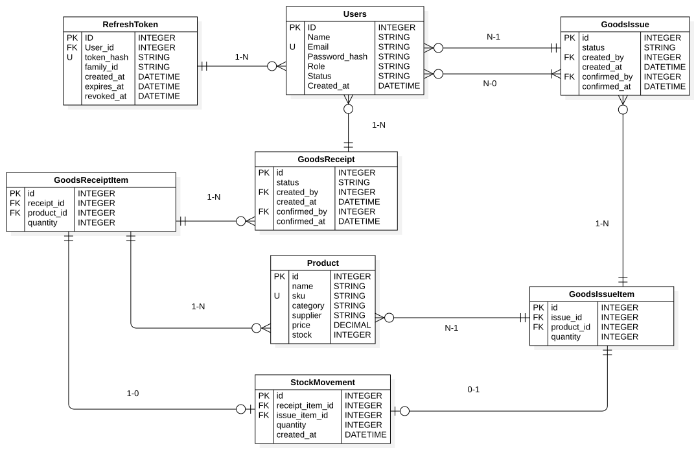

# ERD – Inventory Management System (schema hiện tại)

> **Trạng thái:** Bản nháp dựa trên `server/prisma/schema.prisma` và `server/prisma/migrations/0_init/migration.sql` do nhóm cung cấp. Cần bổ sung commit hash tương ứng và sơ đồ `.svg` vẽ bằng StarUML trước khi mở PR.

## 1. Mục tiêu và phạm vi

Tài liệu mô tả cấu trúc 8 bảng hiện tại của Inventory Management System, gồm PK, FK, quan hệ, bội số, quy tắc xóa và ràng buộc dữ liệu. Phạm vi **không bao gồm** các bảng dự kiến ở Epic B3 như `suppliers`, lô hàng hoặc nhiều kho.

**Nguồn dữ liệu:**

- `server/prisma/schema.prisma` (các model và `@relation`)
- `server/prisma/migrations/0_init/migration.sql` (SQL thực tế, UNIQUE/CHECK/index/FK)
- Commit tham chiếu: `38d4b1539161fe15b330f6d52aa6088615d668d4`

## 2. Sơ đồ

> Xuất ảnh ERD từ StarUML thành `docs/diagrams/erd.svg`. File nguồn StarUML: `docs/diagrams/src/erd.mdj`.

## 3. Danh sách bảng và cột chính

### 3.1. `users`
- `id`: INTEGER, **PK**, tự tăng (`GENERATED ALWAYS AS IDENTITY`)
- `name`: TEXT, NOT NULL
- `email`: TEXT, NOT NULL, **UNIQUE**
- `password_hash`: TEXT, NOT NULL
- `role`: TEXT, NOT NULL, mặc định `staff`, chỉ nhận `admin` / `staff`
- `status`: TEXT, NOT NULL, mặc định `active`, chỉ nhận `pending` / `active` / `locked`
- `created_at`: TIMESTAMPTZ, NOT NULL, mặc định NOW()

### 3.2. `refresh_tokens`
- `id`: INTEGER, **PK**, tự tăng
- `user_id`: INTEGER, NOT NULL, **FK** → `users.id`
- `token_hash`: TEXT, NOT NULL, **UNIQUE**
- `family_id`: UUID, NOT NULL
- `created_at`: TIMESTAMPTZ, NOT NULL, mặc định NOW()
- `expires_at`: TIMESTAMPTZ, NOT NULL
- `revoked_at`: TIMESTAMPTZ, NULL
- Index: `family_id`, `user_id`

### 3.3. `products`
- `id`: INTEGER, **PK**, tự tăng
- `name`: TEXT, NOT NULL
- `sku`: TEXT, NOT NULL, **UNIQUE**
- `category`: TEXT, NOT NULL
- `supplier`: TEXT, NOT NULL
- `price`: NUMERIC(14,2), NOT NULL, mặc định 0, **CHECK `price >= 0`**
- `stock`: INTEGER, NOT NULL, mặc định 0, **CHECK `stock >= 0`**
- `created_at`: TIMESTAMPTZ, NOT NULL, mặc định NOW()

### 3.4. `goods_receipts`
- `id`: INTEGER, **PK**, tự tăng
- `status`: TEXT, NOT NULL, mặc định `draft`, chỉ nhận `draft` / `confirmed`
- `created_by`: INTEGER, NOT NULL, **FK** → `users.id`
- `created_at`: TIMESTAMPTZ, NOT NULL, mặc định NOW()
- `confirmed_by`: INTEGER, NULL, **FK** → `users.id`
- `confirmed_at`: TIMESTAMPTZ, NULL

### 3.5. `goods_receipt_items`
- `id`: INTEGER, **PK**, tự tăng
- `receipt_id`: INTEGER, NOT NULL, **FK** → `goods_receipts.id`
- `product_id`: INTEGER, NOT NULL, **FK** → `products.id`
- `quantity`: INTEGER, NOT NULL, **CHECK `quantity > 0`**
- **UNIQUE (`receipt_id`, `product_id`)**: cùng một phiếu không có hai dòng cho cùng sản phẩm

### 3.6. `goods_issues`
- `id`: INTEGER, **PK**, tự tăng
- `status`: TEXT, NOT NULL, mặc định `draft`, chỉ nhận `draft` / `confirmed`
- `created_by`: INTEGER, NOT NULL, **FK** → `users.id`
- `created_at`: TIMESTAMPTZ, NOT NULL, mặc định NOW()
- `confirmed_by`: INTEGER, NULL, **FK** → `users.id`
- `confirmed_at`: TIMESTAMPTZ, NULL

### 3.7. `goods_issue_items`
- `id`: INTEGER, **PK**, tự tăng
- `issue_id`: INTEGER, NOT NULL, **FK** → `goods_issues.id`
- `product_id`: INTEGER, NOT NULL, **FK** → `products.id`
- `quantity`: INTEGER, NOT NULL, **CHECK `quantity > 0`**
- **UNIQUE (`issue_id`, `product_id`)**: cùng một phiếu không có hai dòng cho cùng sản phẩm

### 3.8. `stock_movements`
- `id`: INTEGER, **PK**, tự tăng
- `receipt_item_id`: INTEGER, NULL, **FK** → `goods_receipt_items.id`; UNIQUE khi khác NULL
- `issue_item_id`: INTEGER, NULL, **FK** → `goods_issue_items.id`; UNIQUE khi khác NULL
- `quantity`: INTEGER, NOT NULL, **CHECK `quantity > 0`**
- `created_at`: TIMESTAMPTZ, NOT NULL, mặc định NOW()
- **CHECK `num_nonnulls(receipt_item_id, issue_item_id) = 1`**: mỗi bản ghi bắt buộc thuộc **đúng một** dòng phiếu nhập **hoặc** dòng phiếu xuất; không thể đồng thời thuộc cả hai, cũng không thể cả hai cùng NULL.

## 4. Danh sách 11 quan hệ cần nối trên ERD

| # | Bảng cha (PK) | Bảng con (FK) | Bội số và ý nghĩa | ON DELETE |
|---|---|---|---|---|
| 1 | `users.id` | `refresh_tokens.user_id` | 1 user có 0..n token; mỗi token thuộc 1 user | CASCADE |
| 2 | `users.id` | `goods_receipts.created_by` | 1 user có thể tạo 0..n phiếu nhập; mỗi phiếu có 1 creator | NO ACTION |
| 3 | `users.id` | `goods_receipts.confirmed_by` | 1 user xác nhận 0..n phiếu nhập; mỗi phiếu có 0..1 confirmer | NO ACTION |
| 4 | `users.id` | `goods_issues.created_by` | 1 user có thể tạo 0..n phiếu xuất; mỗi phiếu có 1 creator | NO ACTION |
| 5 | `users.id` | `goods_issues.confirmed_by` | 1 user xác nhận 0..n phiếu xuất; mỗi phiếu có 0..1 confirmer | NO ACTION |
| 6 | `goods_receipts.id` | `goods_receipt_items.receipt_id` | 1 phiếu nhập có 0..n dòng; mỗi dòng thuộc 1 phiếu | CASCADE |
| 7 | `products.id` | `goods_receipt_items.product_id` | 1 sản phẩm có 0..n dòng nhập; mỗi dòng thuộc 1 sản phẩm | NO ACTION |
| 8 | `goods_issues.id` | `goods_issue_items.issue_id` | 1 phiếu xuất có 0..n dòng; mỗi dòng thuộc 1 phiếu | CASCADE |
| 9 | `products.id` | `goods_issue_items.product_id` | 1 sản phẩm có 0..n dòng xuất; mỗi dòng thuộc 1 sản phẩm | NO ACTION |
| 10 | `goods_receipt_items.id` | `stock_movements.receipt_item_id` | 1 dòng nhập có 0..1 movement; movement có 0..1 tham chiếu đến dòng nhập | NO ACTION |
| 11 | `goods_issue_items.id` | `stock_movements.issue_item_id` | 1 dòng xuất có 0..1 movement; movement có 0..1 tham chiếu đến dòng xuất | NO ACTION |

**Ghi chú bắt buộc trên ERD:** Hai FK của `stock_movements` có tính chất *XOR* — phải đúng một trường khác NULL. Các đường nối 0..1 riêng lẻ không đủ diễn tả điều kiện tổng hợp này.

## 5. Quy tắc và ràng buộc cần kiểm tra

1. `users.email`, `products.sku`, `refresh_tokens.token_hash` là duy nhất.
2. `users.role` ∈ {`admin`, `staff`}; `users.status` ∈ {`pending`, `active`, `locked`}.
3. Phiếu nhập và phiếu xuất chỉ có trạng thái `draft` hoặc `confirmed` theo migration này.
4. `products.price >= 0`; `products.stock >= 0`; số lượng các dòng phiếu và movement luôn `> 0`.
5. Không trùng một `product_id` trong cùng một phiếu nhập hoặc cùng một phiếu xuất.
6. `stock_movements` chỉ có một trong hai nguồn nhập/xuất (XOR); mỗi dòng phiếu có tối đa một movement.
7. Xóa `users` sẽ xóa các `refresh_tokens` liên quan; xóa phiếu sẽ xóa các dòng phiếu liên quan. Các quan hệ khác không dùng CASCADE trong hai file nguồn.

## 6. Assumptions / phạm vi suy luận

- Số lượng `0..n` của dòng phiếu là bội số **được schema cho phép**, không khẳng định nghiệp vụ chấp nhận xác nhận phiếu không có dòng hàng. Quy tắc đó cần kiểm tra ở Service.
- `confirmed_by` và `confirmed_at` đều nullable nhưng schema không có CHECK buộc hai trường cùng có giá trị; nghiệp vụ có thể bổ sung ràng buộc ở Service.
- `products.stock` đang lưu trực tiếp trong bảng `products`; lịch sử movement lưu riêng. Hai file chưa đủ xác nhận có cơ chế tự kiểm tra/đối soát chênh lệch tự động.
- `products.supplier` hiện là cột TEXT, **chưa** có bảng `suppliers` trong phạm vi schema này.
- Không có bảng lô, hạn sử dụng hoặc kho riêng trong hai file đã đọc.
- Tên bảng được lấy từ `@@map` và các câu `CREATE TABLE` (snake_case), không lấy từ tên model Prisma (PascalCase).

