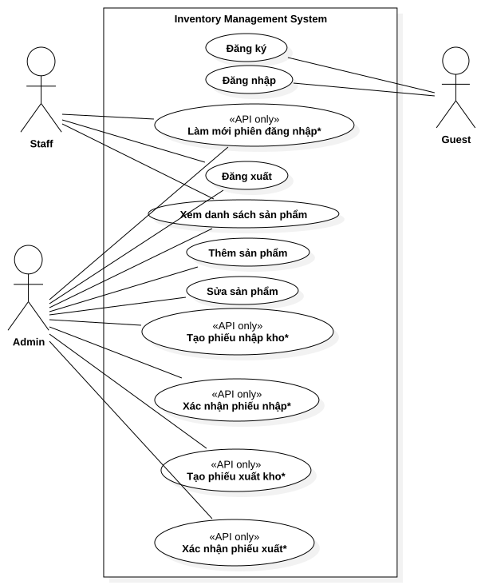

# Use Case Diagram – Inventory Management System (BA2)

## 1. Mô tả

Sơ đồ Use Case mô tả những chức năng **đã được khai báo trong các route backend và các màn hình hiện có** của Inventory Management System, dựa trên mã nguồn được dùng để thực hiện BA2. Hệ thống có ba actor chính: **Guest** (khách chưa đăng nhập), **Staff** (nhân viên) và **Admin** (quản trị viên). Các chức năng tạo và xác nhận phiếu nhập/xuất hiện có API nhưng chưa được thể hiện bằng màn hình riêng trong `App.jsx`, nên được đánh dấu `«API only»`. Sơ đồ phản ánh **hiện trạng kỹ thuật**, không tự đưa các nghiệp vụ tương lai từ tài liệu #79 vào như thể đã triển khai.

### Sơ đồ

- File StarUML chỉnh sửa được: [`src/use-case.mdj`](./src/use-case.mdj)
- File hình xuất từ StarUML: [`use-case.svg`](./use-case.svg)

> **Lưu ý:** Hai đường dẫn trên trỏ tới các file cần nộp cùng tài liệu này trong PR. File Markdown không thay thế file `.mdj` hoặc `.svg`.

## 2. Nguồn tham chiếu

| Nguồn | Mục đích |
|---|---|
| [Issue #125 – BA2: Use case: actor và chức năng (hiện trạng)](https://github.com/1275-B24-Academy/inventory-system/issues/125) | Phạm vi và tiêu chí nghiệm thu |
| [Issue #79 – Bối cảnh doanh nghiệp & người dùng của hệ thống](https://github.com/1275-B24-Academy/inventory-system/issues/79) | Nghiệp vụ mục tiêu của Công ty Phân phối Minh An |
| [Issue #111 – Epic BA](https://github.com/1275-B24-Academy/inventory-system/issues/111) | Thuật ngữ và cấu trúc tài liệu BA |
| [`server/src/routes/auth.routes.js`](../../server/src/routes/auth.routes.js) | Các API xác thực |
| [`server/src/routes/product.routes.js`](../../server/src/routes/product.routes.js) | Các API sản phẩm và kiểm tra role |
| [`server/src/routes/goodsReceipt.routes.js`](../../server/src/routes/goodsReceipt.routes.js) | Các API phiếu nhập kho |
| [`server/src/routes/goodsIssue.routes.js`](../../server/src/routes/goodsIssue.routes.js) | Các API phiếu xuất kho |
| [`client/src/App.jsx`](../../client/src/App.jsx) | Các route giao diện: `/register`, `/login`, `/products` |

**Commit `main` được sử dụng làm nguồn:** `TODO: d582433052d659ddb33de17699481b6e80e24db3`.

> Các file route trong ảnh chụp VS Code có ký hiệu `M` (đã sửa ở working tree). Trước khi nộp, cần đối chiếu các nội dung này với commit `main` được ghi ở trên và cập nhật tài liệu/sơ đồ nếu có chênh lệch.

## 3. Actor

| Actor | Mô tả | Quyền/chức năng thể hiện trong sơ đồ |
|---|---|---|
| **Guest** | Người dùng chưa đăng nhập. | Đăng ký, đăng nhập. |
| **Staff** | Người dùng đã đăng nhập, có role `staff`. | Xem danh sách sản phẩm, đăng xuất và sử dụng cơ chế làm mới phiên. |
| **Admin** | Người dùng đã đăng nhập, có role `admin`. | Xem/thêm/sửa sản phẩm; tạo và xác nhận phiếu nhập/xuất kho; đăng xuất và sử dụng cơ chế làm mới phiên. |

Theo #79, **Thủ kho** và **Nhân viên kinh doanh** cùng dùng role `staff`, còn **Giám đốc** và **Kế toán** cùng dùng role `admin` (chưa có role kế toán riêng). Vì vậy, sơ đồ hiện trạng sử dụng **role trong code**, không tách thêm bốn actor theo chức danh công việc.

## 4. Danh sách Use Case và đối chiếu API/giao diện

Bảng bên dưới ánh xạ **11 route** từ bốn file backend với Use Case trong sơ đồ. Đường dẫn được ghi **tương đối với từng router**; tiền tố đầy đủ phụ thuộc cách router được mount trong server.

| ID | Use Case | Actor trong sơ đồ | Nguồn route / phương thức | Có màn hình hay chỉ API? |
|---|---|---|---|---|
| UC-01 | Đăng ký | Guest | `auth.routes.js` – `POST /register` | **Có màn hình** `/register` |
| UC-02 | Đăng nhập | Guest | `auth.routes.js` – `POST /login` | **Có màn hình** `/login` |
| UC-03 | Làm mới phiên đăng nhập | Staff, Admin (người dùng có phiên) | `auth.routes.js` – `POST /refresh` | **Chỉ API** (`«API only»`) |
| UC-04 | Đăng xuất | Staff, Admin | `auth.routes.js` – `POST /logout` | **Có API**; cần xác minh nút đăng xuất trong component giao diện, vì `App.jsx` không khai báo màn hình riêng |
| UC-05 | Xem danh sách sản phẩm | Staff, Admin | `product.routes.js` – `GET /` | **Có màn hình** `/products` |
| UC-06 | Thêm sản phẩm | Admin | `product.routes.js` – `POST /` | **Có giao diện Products** (theo sơ đồ và phần giao diện được kiểm thử); cần kiểm tra component tại commit nguồn |
| UC-07 | Sửa sản phẩm | Admin | `product.routes.js` – `PUT /:id` | **Có giao diện Products** (theo sơ đồ và phần giao diện được kiểm thử); cần kiểm tra component tại commit nguồn |
| UC-08 | Tạo phiếu nhập kho | Admin | `goodsReceipt.routes.js` – `POST /` | **Chỉ API** (`«API only»`) |
| UC-09 | Xác nhận phiếu nhập | Admin | `goodsReceipt.routes.js` – `POST /:id/confirm` | **Chỉ API** (`«API only»`) |
| UC-10 | Tạo phiếu xuất kho | Admin | `goodsIssue.routes.js` – `POST /` | **Chỉ API** (`«API only»`) |
| UC-11 | Xác nhận phiếu xuất | Admin | `goodsIssue.routes.js` – `POST /:id/confirm` | **Chỉ API** (`«API only»`) |

**Giải thích dấu `*` trong sơ đồ:** Một số Use Case gắn dấu `*` trong tên để nhắc đến các chức năng cần ghi chú/đối chiếu thêm. Dấu này **không phải ký hiệu UML chuẩn** và **không tạo thêm quyền** cho actor. Khi hoàn thiện bản cuối, nên xóa dấu `*` nếu đã có chú thích rõ trong tài liệu này, hoặc bổ sung Note giải nghĩa ngay trên sơ đồ.

### Kiểm tra quyền từ middleware

- `product.routes.js` dùng `requireLogin` và `loadCurrentUser` cho toàn bộ route; `GET /` không yêu cầu role `admin`, còn `POST /` và `PUT /:id` có `requireRoles(["admin"])`.
- `goodsReceipt.routes.js` và `goodsIssue.routes.js` đều áp dụng `requireLogin`, `loadCurrentUser` và `requireRoles(["admin"])` cho toàn bộ router. Vì vậy, **Staff không được nối** với bốn Use Case lập/xác nhận phiếu trong sơ đồ hiện trạng.
- `auth.routes.js` không gắn middleware phân quyền ngay tại các dòng đăng nhập, đăng ký, refresh, logout. Quy tắc phiên chính xác của refresh/logout phải xác minh thêm trong `authController`.
- `App.jsx` chỉ bảo vệ `/products` bằng `isAuthenticated`, **không kiểm tra role** tại route giao diện. Phân quyền thao tác thêm/sửa và nhập/xuất nằm ở backend.

## 5. Đối chiếu theo #79 và code hiện trạng

| Actor | Theo #79 – nghiệp vụ mục tiêu | Theo code – hiện trạng mô tả trên sơ đồ | Điểm cần làm rõ |
|---|---|---|---|
| **Guest** | #79 không mô tả chi tiết chức năng của khách chưa đăng nhập. | Có màn hình đăng ký và đăng nhập. | Phạm vi cho phép đăng ký tự do có phù hợp mô hình doanh nghiệp nội bộ? |
| **Staff** | Thủ kho lập phiếu nhập, phiếu xuất và nhập số đếm kiểm kê; Nhân viên kinh doanh lập phiếu xuất SALE kèm giá bán. | Được xem danh sách sản phẩm; **không có quyền** tạo/xác nhận phiếu nhập/xuất theo middleware hiện tại. | Quyền lập phiếu nhập/xuất của Staff đang khác mục tiêu. Chức năng kiểm kê chưa nằm trong các route đang khảo sát. |
| **Admin** | Giám đốc duyệt phiếu, xem báo cáo Nhập–Xuất–Tồn/lãi gộp, duyệt kiểm kê; Kế toán xem báo cáo và xuất Excel. | Được xem/thêm/sửa sản phẩm và **vừa tạo vừa xác nhận** phiếu nhập/xuất qua API. | Cần làm rõ quy tắc tách người lập/người duyệt; báo cáo, kiểm kê và xuất Excel chưa được thể hiện trong phạm vi các file khảo sát. |

Bảng trên **không kết luận** mọi nghiệp vụ còn thiếu đều là bug: một số chức năng thuộc backlog tương lai, nằm ngoài phạm vi của BA2.

## 6. Assumptions (Giả định và quyết định mô hình hóa)

1. **Chỉ dùng ba actor Guest, Staff, Admin** theo role được thể hiện trong code và yêu cầu của #125. Các chức danh Giám đốc/Thủ kho/Kinh doanh/Kế toán trong #79 không được tách thành role riêng.
2. **Không vẽ “Hệ thống” thành actor**: Inventory Management System là đối tượng được mô tả bởi khung hệ thống, không phải hệ thống bên ngoài đang tương tác với chính nó.
3. **Làm mới phiên đăng nhập** (`POST /refresh`) là chức năng kỹ thuật gọi qua API, thường do client thực hiện khi cần. Trong sơ đồ, chức năng được liên hệ với Staff/Admin như những người dùng đang có phiên; đây **không phải** thao tác họ nhất thiết tự bấm. Cần xác minh điều kiện phiên ở controller.
4. **Không dùng `«include»` giữa “Tạo phiếu” và “Xác nhận phiếu”**: code khai báo các API độc lập; việc tạo phiếu chưa đủ để khẳng định luôn tự xác nhận. Yêu cầu đăng nhập được xem là **điều kiện trước**, không phải cứ thực hiện mỗi Use Case là đăng nhập lại.
5. Nhãn `«API only»` chỉ chức năng đã có API nhưng **không có màn hình được khai báo trong `App.jsx`**; nếu component khác có giao diện tương ứng thì phải cập nhật nhãn sau khi rà soát.
6. Không bổ sung **Xóa sản phẩm** vì `product.routes.js` trong nguồn được cung cấp không có route `DELETE`. Không đưa các tính năng tương lai như duyệt theo quy trình, giữ hàng, kiểm kê hay báo cáo vào sơ đồ hiện trạng nếu chưa có code tương ứng.
7. Các liên kết actor trong sơ đồ biểu diễn **quyền theo route hiện tại**, không biểu diễn quyền mong muốn theo tài liệu #79.

